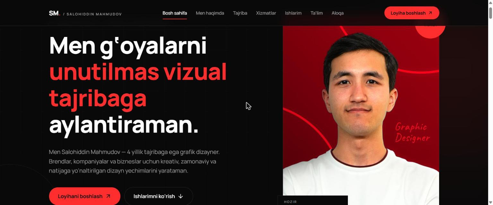

# Salohiddin Mahmudov — Portfolio

🔗 **Jonli sayt: [mahmudovpro.netlify.app](https://mahmudovpro.netlify.app/)**



React + TypeScript + Vite + Tailwind CSS v4 + Framer Motion + Lucide.

## Ishga tushirish
```bash
npm install
npm run dev      # lokal
npm run build    # production -> dist/
```

## Kontentni yangilash
| Nima | Qayerda |
|---|---|
| Telefon, havolalar, statistika, asosiy rasm nomlari | `src/data/site.ts` |
| Portfolio ishlari | `src/data/portfolio.ts` (rasm: `src/assets/images/portfolio/`) |
| Ish tajribasi | `src/data/experience.ts` |
| Hamkorliklar | `src/data/collaborations.ts` |
| Xizmatlar | `src/data/services.ts` |

Rasmlar: faylni `src/assets/images/` ichiga tashlang va data faylida **fayl nomini** yozing.
Fayl topilmasa, joyida placeholder ko'rinadi. Portfoliodagi hozirgi 8 ta yozuv — **namuna** (`placeholder: true`);
haqiqiy ish qo'shgach shu maydonni olib tashlang.

Kerakli fayl nomlari: `portrait-salohiddin.jpg`, `portrait-about.jpg`, `teaching-classroom-1.jpg`,
`teaching-classroom-2.jpg`, `logo-toyona-savdo.png`, `logo-qahvachi-cafe.png`, `logo-mendeleyev.png`,
`logo-uz-km.png`, `logo-ads-uz.png`, `portfolio/*.jpg`.

Favicon: `public/favicon.svg`. OG rasm: `public/og-image.jpg` + `index.html` ichidagi izohni oching.

## Aloqa shakli
Backend yo'q. Shakl tekshiriladi, xabar tayyorlanadi, nusxalanadi va Telegram
(`t.me/maxmudov_salohiddin?text=...`) ochiladi. Foydalanuvchi Telegramda "Yuborish"ni o'zi bosadi;
sayt "yuborildi" demaydi.
